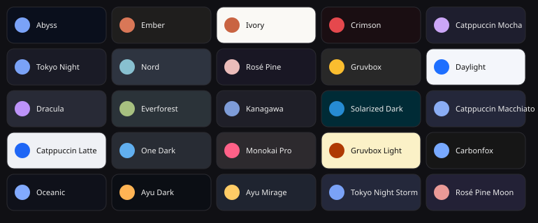

<div align="center">


# Abyss

**An Android super-app: a multi-provider AI chat wrapped around a living, physics-driven interface, plus a suite of self-contained tools — a map/aviation radar, an on-device translator, notes, alarms, a calculator and a proxy client.**

Single-module Kotlin + Jetpack Compose app. Target: Android 16 (minSdk 29), arm64-v8a.

</div>

---

## Table of contents

1. [What it is](#what-it-is)
2. [The living background](#the-living-background)
3. [Chat](#chat)
4. [Tools](#tools)
   - [Radar](#radar--радар-неба)
   - [Translator](#translator)
   - [Notes](#notes) · [Alarms](#alarms) · [Calculator](#calculator)
   - [Proxy client](#proxy-client)
5. [Themes & palettes](#themes--palettes)
6. [Localization](#localization)
7. [Settings](#settings)
8. [Architecture](#architecture)
9. [Build & delivery](#build--delivery)
10. [Roadmap](#roadmap)

> **Screenshots:** live device captures live in `docs/screens/` — drop PNGs there and they render below. The cloud build can't capture a running device, so the previews here are the app's own logo and the real palette set generated from source.

<div align="center"></div>

---

## What it is

Abyss is one Compose `Activity` with three tabs — **Chat**, **Tools**, **Settings** — kept alive behind a floating pill navigation. Every screen is drawn over a single app-wide animated water surface that reacts to touch and to the UI itself. The AI layer is provider-agnostic: you bring your own API key (or run a local model), and the app routes messages through a small agent system.

Everything is local-first: keys are stored encrypted on the device, chat history is a local Room database, and the tools each talk to public APIs directly from the phone.

---

## The living background

A custom fluid/visual engine shared by the whole app (`ui/background/`).

- **Off-thread water simulation** (`WaterSim.kt`). A shallow-water-style height field runs on its own thread (triple-buffered), fed by taps, drags, hold-to-charge pulses, ambient drips and invisible "wanderers" that cross the surface leaving wakes. It never blocks the UI thread.
- **AGSL shaders** (`WATER_SRC`, `OVER_SRC`). On Android 13+ the height field is rendered by a runtime shader with luminescent crests, specular glints, phosphorescent bloom and an aurora refracted by the surface slope. A coarse grid is reconstructed with a **smooth-bilinear (quintic) warp** so wavefronts never show per-cell facets ("pixelation"), while the emission is tuned for volume and glow.
- **UI elements are obstacles.** Any composable tagged `Modifier.abyssObstacle(corner)` registers its exact rounded-rect outline; the water bounces off it (with a glowing rim), slips under it or rolls over it, chosen per element over time.
- **Glyph field.** Hundreds of faint English letters and binary digits drift upward in parallax layers, drawn in a single `drawVertices` call.
- **Device-tilt parallax** via the gravity/accelerometer sensor.
- **Power-saving mode.** Tap the black-hole mark on the chat start screen: it swells ~4×, visually *sucks the entire living field into itself* (a luminescent shockwave rolls out of the real wave engine at the peak), then returns to rest. The water, glyphs and shaders are then not composed at all — only button and page-transition animations remain. Tapping again reverses it like a white hole. The same mode is a plain toggle in **Settings → You → Power saving** (instant, no animation). State is persisted.
- **Transition budget.** While a tab slides, the background freezes its last frame (no sim step, no redraw, no obstacle churn) so the whole frame budget goes to a clean 120 Hz switch.

---

## Chat

- **Multi-provider.** Providers are pluggable (`core/provider/`): OpenAI-compatible, Anthropic, Gemini and a local GGUF runner share one `LlmProvider` interface. Each provider exposes free and keyed models (see [AI providers & keys](#ai-providers--keys)).
- **Agents.** A lightweight agent registry (`core/agent/`) with an `auto` router plus named agents; the top bar shows the active (and routed) agent.
- **Streaming** responses with a kept-alive, non-recomposing render path (streaming a token no longer re-lays the shell).
- **Conversations** persist in Room; a left drawer lists them (opened from the menu button — no swipe-to-open). New chat, delete, theme picker and settings live there.
- **Inline translation** (X-style): foreign messages can auto-translate on-device; tap to toggle original/translation.
- **Start screen** ("Hero"): a typed greeting, a composer and suggestion chips; the black-hole mark doubles as the power-saving switch.
- **Media**: capture/attach images for vision-capable models.

### AI providers & keys

Keys are entered per provider in **Settings** and stored encrypted (`core/keys/KeyStore`, Android Keystore-backed).

- **No key →** the genuinely keyless paths are available: the **on-device local model** (load a GGUF by URL) and any provider model marked free-tier.
- **With a key →** that provider's full model list unlocks, gated by what the key itself is entitled to (free-tier keys see free models; paid keys unlock paid models).
- The registry lists the current model families (OpenAI, Anthropic Claude, Google Gemini, DeepSeek, Copilot-style endpoints, and OpenAI-compatible gateways such as OpenRouter) so you can point any OpenAI-compatible base URL + key at Abyss.

> Abyss never ships someone else's credentials: proprietary paid models always require **your own** key (a free-tier key or a paid one). There is no bundled shared access.

---

## Tools

A grid hub (`ui/feature/tools/ToolsHub.kt`) opening each tool with a slide/fade transition.

### Radar — «Радар неба»

A full map + live-data tool built on osmdroid, rendered key-free.

**Map & gestures.** osmdroid is used purely as a renderer; all touch is handled by a custom, unit-tested gesture engine (`MapCamera`, `MapGestureEngine`) that drives a pure camera: one-finger drag + inertial fling, pinch-zoom + pan + rotate together, double-tap and double-tap-drag zoom, two-finger-tap zoom-out, long-press, mouse wheel, and eased `flyTo` with a zoom-out arc on long hops. A scale bar and a rotating compass button round it out. Basemaps (OSM day/night-inverted, Esri satellite, OpenTopoMap, transport) are all key-free.

**Aircraft.** Live positions merged from four public ADS-B networks (adsb.lol, airplanes.live, adsb.fi, OpenSky) per ICAO hex, with dead-reckoning between fixes, per-host rate-limit gating, and the **adsbdb** registry for type/operator/route/photo. A "data sources" panel shows per-network counts; an in-view list focuses and follows a plane; filters for military/emergency/airborne.

**Roads.** Traffic flow, incidents and cameras from public sources: TomTom (flow tiles + incidents) and HERE (incidents) with your own free keys; key-free OpenStreetMap enforcement/traffic cameras via Overpass, plus open government feeds (Finland Digitraffic, BC DriveBC Open511, Singapore LTA). Cross-source de-duplication and severity ranking; coloured/dashed incident lines, camera cards with live images.

**Public-safety layer.** Region-level air-raid alert status from the official alerts.in.ua feed (your own free token) with a precise banner for your oblast/hromada, a **nearest-shelter finder** (shelters from OpenStreetMap: bomb shelters, civil-defence buildings, metro, underground parking) with walking directions, a background watcher (silent vibration + heads-up on alert/all-clear, restarts after reboot) and a local alert history.

**Geolocation tools** on any dropped pin: coordinates in **decimal / DMS / UTM / MGRS** (copyable), **sun & shadow** (azimuth, elevation, shadow bearing & length, sunrise/solar-noon/sunset, polar day/night) for chronolocation, and **"Open in…"** deep links (OSM, Google Maps/Street View/Earth, Bing, Yandex, OpenTopoMap, Windy, SunCalc).

**Overlays & misc.** Weather radar (RainViewer), Wikipedia places nearby, a USGS-earthquake + news **events** layer with filters (quakes/news/min-magnitude), a day/night terminator, place & coordinate search, saved places (bookmarks), and a measuring tool.

> The pure logic of each of the above (camera math, gesture recognition, merge, coordinate/sun math, alert matching, shelter selection, filters) is covered by JVM unit tests.

### Translator

On-device translation (ML Kit) with an optional LLM engine; language auto-detect; per-language mute list; the same engine powers Chat's inline translation.

### Notes

Local notes with the house typography.

### Alarms

Exact alarms (`AlarmManager`), a full-screen ring activity that shows over the lock screen, and re-arming after reboot.

### Calculator

A calculator tool in the hub.

### Proxy client

A VPN/proxy client (`feature/vpn/`): imports `vmess` / `vless` / `trojan` / `shadowsocks` share links and subscriptions, builds an Xray-core JSON config (TLS/Reality/ws/grpc/httpupgrade transports), and runs it through a `VpnService` with a local SOCKS inbound + TUN forwarder. Includes a concurrent **server speed test** (TCP latency, sortable) and honest subscription-import feedback. The native engine ships only in the `-PwithVpn` build; link parsing, subscriptions and the speed test work without it.

---

## Themes & palettes

**25 built-in palettes** (above), each restyling the whole app at once — Compose colours *and* the shader background. Includes Abyss, Ember, Ivory, Crimson, Daylight and 15 popular community schemes: Catppuccin (Mocha/Macchiato/Latte), Tokyo Night (+Storm), Nord, Rosé Pine (+Moon), Gruvbox (dark/light), Dracula, Everforest, Kanagawa, Solarized Dark, One Dark, Monokai Pro, Carbonfox, Oceanic, Ayu (Dark/Mirage). Switching a palette rolls a wave across the screen.

## Localization

Full UI in **10 languages** — English, Russian, Ukrainian, Spanish, German, French, Portuguese, Turkish, Chinese, Japanese — with system auto-detect plus a manual picker. Strings live in an abstract `Strings` class with one `StringsXx.kt` per language.

## Settings

Personalisation (name, theme, language, **power-saving**), model/provider selection, per-provider API keys, generation controls (temperature, system prompt), the translator, and privacy toggles (permissions, scam-call guard, optional background self-improvement). An on-device **local model** manager loads a GGUF by URL.

---

## Architecture

```
app/src/main/java/com/abyss/app/
├─ core/
│  ├─ provider/      LlmProvider + OpenAI-compat, Anthropic, Gemini, local GGUF
│  ├─ agent/         agent registry + auto router
│  ├─ keys/          encrypted KeyStore
│  ├─ settings/      DataStore-backed AbyssSettings
│  ├─ data/          Room (conversations, notes, alarms)
│  └─ translate/     ML Kit + LLM translation
├─ feature/
│  ├─ radar/         pure logic: MapCamera, MapGestures, Aviation, RoadApi/Model,
│  │                 SafetyApi/Model, GeoFormats, SunMath, GeoLinks, Bookmarks, …
│  ├─ vpn/           Xray config, subscription parser, VpnService, ping
│  └─ alarm/         scheduler, ring activity, boot receiver
└─ ui/
   ├─ background/    WaterSim + AGSL shaders + glyph field + power-save
   ├─ chat/          chat screen, drawer, composer, hero
   ├─ feature/…      per-tool Compose UIs
   ├─ theme/         25 palettes
   └─ i18n/          Strings × 10 languages
```

**Principles:** pure, framework-free logic for anything testable (geometry, parsing, merging, scoring) with JVM unit tests; snapshot-free hot paths; render-thread-only animations (`graphicsLayer`) for transitions; network only from the phone, rate-limited and defensive.

## Build & delivery

- GitHub Actions builds the debug APK (`arm64-v8a`) on every push to `main`.
- The APK is published to a GitHub Release (tag `latest`) and mirrored to the orphan `apk` branch in parts with a SHA-256 checksum and a `BUILD.txt`.
- A separate workflow compiles the AGSL shaders to catch shader errors in CI.
- Local pure-logic tests run with a standalone `kotlinc`.

```bash
./gradlew :app:assembleDebug            # standard build
./gradlew :app:assembleDebug -PwithVpn  # + native Xray proxy engine
```

---

## Roadmap

Legend: ✅ done · 🚧 in progress · ⬜ planned

### Core app
- ✅ Multi-provider chat, agents, streaming, conversation history
- ✅ Living water background (sim + AGSL shaders + glyphs + tilt)
- ✅ 10-language localization with auto-detect
- ✅ 25 theme palettes
- ✅ Power-saving mode with the black-hole collapse/expand animation
- ✅ Wave anti-pixelation (smooth-bilinear) + restored luminescence/volume
- ✅ 120 Hz tab transitions (background frozen during the slide)
- 🚧 Continuous animation polish pass
- ⬜ Per-message model switching and cost/usage display
- ⬜ Home-screen widgets (next alert, saved place, quick chat)

### Radar
- ✅ Google-Maps-style gesture engine, key-free basemaps, scale bar & compass
- ✅ 4-network ADS-B merge + registry/route/photo, in-view list, filters
- ✅ Roads: traffic/incidents/cameras (TomTom, HERE, OSM, open government feeds)
- ✅ Public-safety: region alerts + background watcher + nearest-shelter finder
- ✅ Geo-tools: coordinate formats, sun & shadow, map-service links, bookmarks, events filters
- ⬜ Flight history from collected trails
- ⬜ Offline basemap tile caching for a chosen area
- ⬜ Nearby OpenStreetMap feature search by category
- ⬜ Elevation/terrain profile for a pin or a measured line

### Proxy client
- ✅ vmess/vless/trojan/shadowsocks + subscriptions, Xray config (incl. httpupgrade/Reality)
- ✅ Concurrent server speed test + sort, honest import feedback
- ⬜ Per-app split tunnelling
- ⬜ Automatic fastest-server selection and failover

### Platform
- ✅ CI build → Release + `apk` branch, shader-check workflow
- ⬜ On-device build/update tooling
- ⬜ Signed release track

*This file is kept up to date as tasks land.*
